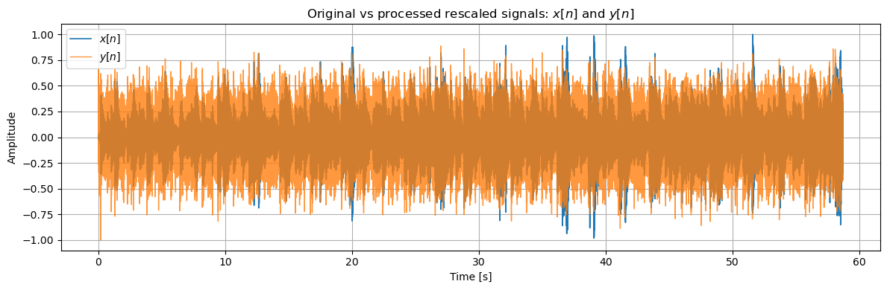
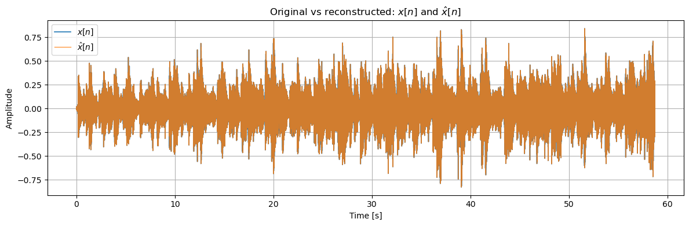
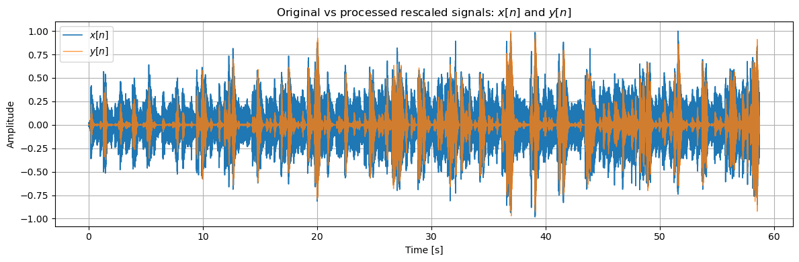

# DRCinv — Audio Compression/Expansion Model-Based Inversion

**DRCinv** is a Python implementation of forward dynamic range compression and expansion, together with model-based inversion for audio signal reconstruction.

This repository accompanies the research work:

> H. Sun, D. Fourer, and H. Maaref, **“Hybrid Model-Driven Inversion of Audio Dynamic Range Compression and Expansion,”** submitted to *IEEE/ACM Transactions on Audio, Speech, and Language Processing*, 2026.

**Project page:** https://hdrc-inv.github.io/
**Source code:** https://github.com/dfourer/DRCinv

> **Publication status:** The project page describes the paper as submitted. Update the citation and add the DOI when the final bibliographic details are available.

## Overview

Dynamic range compression and expansion are widely used to modify the amplitude dynamics of audio signals. DRCinv provides functions to simulate these processes and estimate the original signal from processed audio using a model-based inversion approach.

The implementation exposes two principal functions:

- `drc_forward`: apply dynamic range compression or expansion.
- `drc_inverse`: estimate the original signal from the processed signal, given the model parameters.

## Installation

Install from the project directory during development:

```bash
python -m pip install -e .
```

Once the `drcinv` distribution is published on PyPI, it can be installed with:

```bash
pip install drcinv
```

The package requires Python 3.10 or later, NumPy and SciPy.

## Quick start

```python
import numpy as np
from drcinv import drc_forward, drc_inverse

Fs = 44100
x = 0.1 * np.sin(2 * np.pi * 440 * np.arange(Fs) / Fs)

# [threshold (dBFS), ratio, envelope attack/release (s),
#  gain attack/release (s), detector order]
q = [-20, 4, 0.01, 0.1, 0.01, 0.1, 2]

# Compress and reconstruct
processed = drc_forward(x, Fs, q, mode="comp")
reconstructed = drc_inverse(processed, Fs, q, mode="comp")
```

The parameter vector is `q = [L, R, tau_v_att, tau_v_rel, tau_g_att, tau_g_rel, p]`, where `L` is the threshold in dBFS, `R` is the ratio, the four `tau` values are time constants in seconds, and `p` is the detector order (1 for peak, 2 for RMS-like detection).

Set `mode="comp"` for downward compression or `mode="exp"` for downward expansion. The inverse function also supports the numerical solver option `optim="hybr"` (default) or `optim="brentq"`.

## Illustrations

The following plots reproduce the visual material linked from the [project webpage](https://fourer.fr/drc/). Image paths are relative to this README and assume that the corresponding PNG files are stored in `docs/`.

### Compressor

**Original vs. processed signal**



**Original vs. reconstructed signal**



### Expander

**Original vs. processed signal**



**Original vs. reconstructed signal**


## Full audio demonstration

The repository includes [`examples/demo_drcinv.py`](examples/demo_drcinv.py), a complete audio example that reads [`examples/input.mp3`](examples/input.mp3), applies forward DRC, reconstructs the original signal, and evaluates reconstruction accuracy and processing speed.

Install the library locally and the dependencies required by the example:

```bash
python -m pip install -e .
python -m pip install soundfile matplotlib
```

Run from the repository root:

```bash
python examples/demo_drcinv.py
```

The example loads the MP3 relative to its own location, so it can find `examples/input.mp3` regardless of the working directory. Stereo audio is converted to mono by averaging the channels. The code uses a peak-normalization helper for the listening files; the actual forward and inverse computations use the unnormalized signal.

### Choose compression or expansion

At the beginning of `examples/demo_drcinv.py`, choose the processing mode and inverse solver:

```python
mode = "exp"     # "comp" (compression) or "exp" (expansion)
optim = "hybr"   # "hybr" or "brentq"
```

The example defines separate parameter vectors for compression and expansion. The **compression** settings are:

```python
q = [-45.0, 8.0, 0.001, 0.150, 0.0005, 0.200, 2]
```

The **expansion** settings are:

```python
q = [-10.0, 4.0, 0.003, 0.050, 0.002, 0.080, 2]
```

### Forward processing and reconstruction

The core of the example is:

```python
from drcinv import drc_forward, drc_inverse

# x and Fs are loaded from the input audio file; q and mode are set above.
y = drc_forward(x, Fs, q, mode=mode)
x_rec = drc_inverse(y, Fs, q, mode=mode, optim=optim)

error = x - x_rec
print(f"Max error: {np.max(np.abs(error)):.3e}")
print(f"RMSE: {np.sqrt(np.mean(error**2)):.3e}")
```

Here `x` is the original audio, `y` the compressed or expanded audio, and `x_rec` the reconstructed signal. The full example also reports forward and inverse computation times, maximum and root-mean-square reconstruction errors, changes in RMS level, real-time factors (RTF), and inverse processing speed relative to real time.

### Generated audio and figures

Running the demonstration writes the following listening files to the **current working directory** (where the command is launched):

- `x_listen_comp.wav`, `y_listen_comp.wav`, `x_rec_listen_comp.wav` in compression mode;
- `x_listen_exp.wav`, `y_listen_exp.wav`, `x_rec_listen_exp.wav` in expansion mode.

It also saves individual plots for the original, processed, and reconstructed waveforms, plus comparisons between the original and reconstructed signals and between normalized original and processed signals. The comparison plots are saved as both PDF and PNG; the other plots are saved as PDF. The script calls `plt.show()` to display the figures interactively.

The PNGs under [`docs/`](docs/) are the figures included in the **Illustrations** section above; the demonstration does not automatically write to `docs/`.

### Automated tests

The demonstration is an executable example, not a pytest test. Automated tests belong in `tests/test_drcinv.py` and should contain functions named `test_*`:

```bash
python -m pip install -e ".[test]"
python -m pytest tests/ -v
```

## Citation

If you use this software in academic work, please cite the associated paper. The following entry is **provisional** and should be updated after publication:

```bibtex
@article{sun2026drcinv,
  title   = {Hybrid Model-Driven Inversion of Audio Dynamic Range Compression and Expansion},
  author  = {Sun, H. and Fourer, D. and Maaref, H.},
  journal = {IEEE/ACM Transactions on Audio, Speech, and Language Processing},
  year    = {2026},
  note    = {Submitted manuscript}
}
```

## License

See the `LICENSE` file for the terms applicable to this software. Ensure that the license file is included before public distribution.

## Links

- [Research project page](https://fourer.fr/drc/)
- [GitHub repository](https://github.com/dfourer/DRCinv)
 
